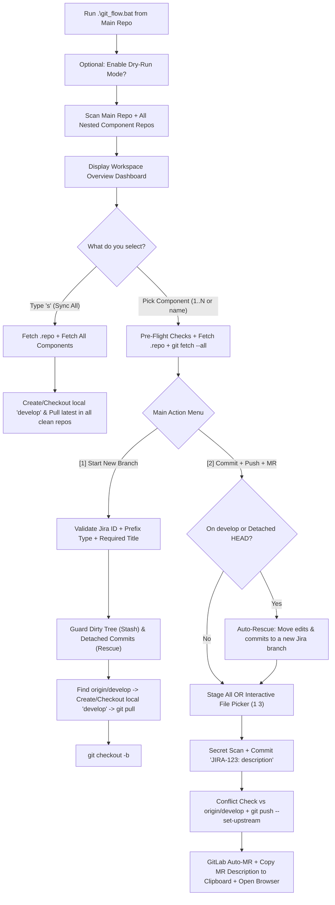

# AUTOSAR Git + Jira + GitLab Complete Documentation (`git_flow` v2.5)

This document covers every detail of the `git_flow` workflow assistant: why it exists, where to put it, how to run it, every screen and prompt in sequence, every safety check and edge case, all command-line flags, environment variables, exit codes, and recovery steps.

---

## Table of Contents

1. [Why This Tool Exists (The AUTOSAR + GitLab Problem)](#1-why-this-tool-exists-the-autosar--gitlab-problem)
2. [Files Included & Where to Place Them](#2-files-included--where-to-place-them)
3. [Quick Start (Daily Workflow in 2 Steps)](#3-quick-start-daily-workflow-in-2-steps)
4. [Detailed Step-by-Step Flow & Every Case Handled](#4-detailed-step-by-step-flow--every-case-handled)
   - [Phase 1: Startup & Dry-Run Mode](#phase-1-startup--dry-run-mode)
   - [Phase 2: Workspace Overview Dashboard (Seeing All Changes)](#phase-2-workspace-overview-dashboard-seeing-all-changes)
   - [Phase 3: Syncing ALL Repositories (`s` or `--sync`)](#phase-3-syncing-all-repositories-s-or---sync)
   - [Phase 4: Pre-Flight Health Checks on a Component](#phase-4-pre-flight-health-checks-on-a-component)
   - [Phase 5: Action 1 — Starting a New Branch](#phase-5-action-1--starting-a-new-branch)
   - [Phase 6: Action 2 — Committing Changes](#phase-6-action-2--committing-changes)
   - [Phase 7: Action 3 — Pushing & Raising the GitLab MR](#phase-7-action-3--pushing--raising-the-gitlab-mr)
   - [Phase 8: Action 4 — Generating MR Text Only](#phase-8-action-4--generating-mr-text-only)
   - [Phase 9: Multi-Component Loop](#phase-9-multi-component-loop)
5. [Fast One-Line CLI Commands (Non-Menu Usage)](#5-fast-one-line-cli-commands-non-menu-usage)
6. [Complete CLI Flags Reference](#6-complete-cli-flags-reference)
7. [Environment Variables (Team Customization)](#7-environment-variables-team-customization)
8. [Exit Codes Reference](#8-exit-codes-reference)
9. [Troubleshooting & Recovery Cheat-Sheet](#9-troubleshooting--recovery-cheat-sheet)
10. [Safe Rollout & First-Time Verification Checklist (Company Codebase)](#10-safe-rollout--first-time-verification-checklist-company-codebase)

---

## 1. Why This Tool Exists (The AUTOSAR + GitLab Problem)

In an AUTOSAR project hosted on GitLab, developers work with a **Main Repository** that contains a `.repo` directory and many **nested component repositories** (e.g., `dcm`, `can`, `rte`, `dem`, `com`).

Doing Git operations manually across nested repos causes frequent mistakes and wasted time:
1. **Forgetting `git fetch --all` in `.repo` and in the component:** Developers start work without fetching the latest remote state.
2. **`develop` not showing up in `git branch`:** Because AUTOSAR components often check out in **Detached HEAD** state (`HEAD detached at <commit>`), running `git branch` does not list `develop` at all—`origin/develop` is only visible in VS Code's **Git Graph**. Developers have to manually find `origin/develop`, create a local tracking `develop` branch, and pull it.
3. **Branching from the wrong place:** Developers forget to switch to `develop` and pull before creating a new branch, accidentally branching off an old branch or stale commit.
4. **Committing directly on `develop` or in `Detached HEAD`:** Developers edit files and commit before realizing they never created a task branch.
5. **Inconsistent branch names & commit messages:** Forgetting the Jira ID or description in branch names (`PROJ-123-title` or `feature/PROJ-123-title`) or in `git commit -m "PROJ-123: description"`, leading to GitLab push-hook or pipeline rejections.
6. **Committing unwanted generated files:** AUTOSAR tools (DaVinci, EB Tresos, code generators) often modify extra `.arxml` or log files that shouldn't be committed with `git add -A`.
7. **Manual upstream push commands:** Having to type `git push --set-upstream origin <long-branch-name>` every time.
8. **Repetitive GitLab MR creation:** Manually copying branch names, commit logs, and descriptions into GitLab.

`git_flow` automates all 8 of these from the **Main Repo folder** while never force-pushing or deleting your work.

---

## 2. Files Included & Where to Place Them

Copy these files into your **Main AUTOSAR Project Root folder**:

```text
My_AUTOSAR_Project/                <-- Place all git_flow files HERE (Main Repo Root)
 ├── .git/                         (Main repository)
 ├── .repo/                        (Optional .repo directory)
 ├── git_flow.bat                  <-- Windows launcher (PowerShell / CMD / Double-click)
 ├── git_flow.ps1                  <-- PowerShell engine (Windows PowerShell 5.1+ / PS 7+)
 ├── git_flow.sh                   <-- Bash engine (Git Bash / WSL / Linux / macOS)
 ├── GIT_FLOW_PLAYBOOK.md          <-- This documentation
 └── components/                   (Nested AUTOSAR component folders)
      ├── can/                     (.git inside)
      ├── dcm/                     (.git inside)
      └── rte/                     (.git inside)
```

### Why is there a `git_flow.bat` file for Windows?
Many corporate Windows laptops block `.ps1` scripts by default with:
`File git_flow.ps1 cannot be loaded. The file is not digitally signed (PSSecurityException).`
Running **`.\git_flow.bat`** automatically invokes PowerShell with `-NoProfile -ExecutionPolicy Bypass` for that single run—so it works on every Windows PC without admin rights. It also pauses before closing if someone double-clicks `git_flow.bat` in Windows File Explorer.

---

## 3. Quick Start (Daily Workflow in 2 Steps)

Always open your terminal in the **Main Project Root** (`My_AUTOSAR_Project/`) and run:

```powershell
# Windows (PowerShell or Command Prompt):
.\git_flow.bat

# Git Bash / Linux:
./git_flow.sh
```

1. **To Start a Task:**
   Run `.\git_flow.bat` -> Pick your component number (e.g., `2` for `dcm`) -> Pick **`[1] Start New Branch`** -> Enter your Jira ID (`PROJ-123`), choose prefix (`[1] none` for `PROJ-123-title` or `[2] feature` for `feature/PROJ-123-title`), and enter the branch title (`fix can parser`).
2. **To Finish a Task & Raise an MR:**
   Run `.\git_flow.bat` -> Pick the component marked with `*` (modified files) -> Pick **`[2] Commit changes (+ Push & Raise GitLab MR)`** -> Enter your commit description (`handle empty frame`).

---

## 4. Detailed Step-by-Step Flow & Every Case Handled

Below is the exact chronological sequence of what happens when you run `.\git_flow.bat` (or `./git_flow.sh`).



---

### Phase 1: Startup & Dry-Run Mode

When you run `.\git_flow.bat` with no flags, the first question is:
```text
Enable Dry Run mode (simulate commands without executing)? [y/N]:
```
- **Press Enter (`N`):** Normal execution mode.
- **Type `y` (or pass `--dry-run` / `-n`):** Safe simulation mode.
  - Read-only checks (`git status`, `git fetch --all`, conflict checks) still run so the preview is 100% accurate.
  - Every command that would modify your repo (`git checkout`, `git pull`, `git add`, `git commit`, `git push`) is **not executed**—it is only printed in yellow as:
    `[dry-run] would run: git ...`

---

### Phase 2: Workspace Overview Dashboard (Seeing All Changes)

Next, the script scans your Main Repo and all nested subfolders (up to depth 10, skipping `build`, `out`, `dist`, `node_modules`, `.venv`, `.repo`, etc.) for Git repositories and displays the **Workspace Overview**:

```text
==> Workspace Overview (4 repositories under C:\Projects\My_AUTOSAR_Project)
    [1]   My_AUTOSAR_Project (Main Repo) [develop]                    -> clean
    [2] * components/can                 [DETACHED@371a656]           -> 2 changed file(s)
             M src/can_driver.c
            ?? cfg/can_temp.arxml
    [3] ^ components/dcm                 [PROJ-123-fix-can-parser]    -> clean (1 unpushed commit(s) ready to push)
    [4]   components/rte                 [develop]                    -> clean
```

#### What every symbol and label means:
- **`[1]..[N]`:** The repository number you can type to select it.
- **`*` (Yellow row):** This repository has **uncommitted modified, staged, or untracked files**. Up to 6 changed file paths are listed directly underneath (`M` = modified, `A` = staged, `??` = untracked) so you can see all changes across your entire AUTOSAR project from the Main Repo.
- **`^` (Cyan row):** This repository's working tree is clean, but it is on a task branch with **local commits that have not been pushed to GitLab yet** (`1 unpushed commit(s) ready to push`).
- **Blank marker (Green/Gray row):** Working tree is clean with nothing unpushed.
- **`[DETACHED@371a656]`:** The component is currently in **Detached HEAD** state at commit `371a656` (common in AUTOSAR checkouts before local `develop` is checked out).

#### What you can type at `Select repository`:
- **A number (`1`–`4`):** Selects that repository.
- **Multiple numbers or names (`2 3` or `can,dcm`):** Launches **Multi-Component Branching** — enter your Jira ID, prefix, and branch title **once**, and the script fetches, syncs `develop`, and creates the exact same branch across all selected components in one step!
- **A component folder name (`dcm` or `components/dcm`):** Finds and selects that component directly. (If two nested repos have the same folder name, it shows a numbered pick-list to disambiguate).
- **`s` (or `0`):** Runs **Sync ALL repos** across the entire workspace (see Phase 3).
- **`q`:** Quits without changing anything.

*(Note: You can also run `.\git_flow.bat --status` anytime to print this dashboard and exit immediately.)*

---

### Phase 3: Syncing ALL Repositories (`s` or `--sync`)

When you type `s` at the repository prompt, pick `[5]` in the action menu, or run `.\git_flow.bat --sync`:

1. **Fetches `.repo` first (if present):**
   - Checks if `<Main_Repo>/.repo` exists and is a Git repository (and checks `.repo/manifests`). If found, runs:
     ```bash
     git -C .repo fetch --all --prune
     ```
2. **Loops through the Main Repo and every nested component repo:**
   In each repository, it runs `git fetch --all --prune` and handles 4 cases safely:

   | Case in Component Repo | What `--sync` Does |
   |---|---|
   | **Case A: `develop` is NOT listed in `git branch` (Detached HEAD)** | Locates `origin/develop` on the remote (even if the repo was cloned with a single-branch refspec, it explicitly fetches `+refs/heads/develop:refs/remotes/origin/develop`), then runs `git checkout -b develop --track origin/develop`. Local `develop` now exists and is up to date! |
   | **Case B: `develop` exists locally and repo is clean** | Switches to `develop` (`git checkout develop`), sets upstream tracking to `origin/develop`, and pulls latest changes (`git pull --ff-only origin develop`). |
   | **Case C: Component has uncommitted file changes** | **Never overwrites your work.** Runs `git fetch --all` in the background, leaves your files and current branch untouched, and logs: `Has uncommitted tracked changes - kept current branch untouched.` |
   | **Case D: Component is on an active task branch (e.g. `PROJ-123-...`)** | **Never switches you off your active task branch.** Fetches latest remote refs in the background and keeps your task branch checked out. |

3. **Prints a final summary:**
   `[OK] Synced to 'develop': 12 | Kept as-is (dirty/feature branch): 2 | Failed: 0`

---

### Phase 4: Pre-Flight Health Checks on a Component

When you select a specific component (e.g., `dcm`), the script automatically enters that component folder and runs **Pre-Flight Checks** before showing the action menu:

1. **Broken Git State Detection:**
   - Checks `.git/` for an unfinished **rebase** (`rebase-merge` / `rebase-apply`), **merge** (`MERGE_HEAD`), **cherry-pick** (`CHERRY_PICK_HEAD`), **revert** (`REVERT_HEAD`), or unresolved merge conflicts (`git diff --diff-filter=U`).
   - If found, it stops immediately and prints the exact `--continue` or `--abort` command so you don't corrupt your history.
2. **Automatic Remote Name Detection:**
   - Defaults to `origin`.
   - If `origin` is not configured in that component (for example, `.repo` manifests sometimes name the remote `gitlab`, `upstream`, or `autosar`), the script automatically inspects `git remote` and selects the remote that carries `develop`.
3. **SSH Hang Protection:**
   - If you don't have a custom `GIT_SSH_COMMAND`, it sets `ssh -o ConnectTimeout=20` so an unplugged VPN fails with a clear message after 20 seconds instead of freezing your terminal indefinitely.
4. **Automatic `.repo` + Component `git fetch --all --prune`:**
   - Fetches `.repo` (if present in the workspace root) and then runs `git fetch --all --prune` in the selected component.
   - **If network/auth fails:** Clearly distinguishes between **VPN/DNS/Proxy unreachable** (exit code `5`, advising you to check VPN or use `--no-fetch`) vs. **Authentication/Permission failure** (SSH key not loaded or GitLab PAT expired).

---

### Phase 5: Action 1 — Starting a New Branch

When you choose **`[1] Start New Branch`** from the menu (or run `.\git_flow.bat -c dcm --branch`):

#### Step 5.1: Jira ID, Prefix Type & Mandatory Branch Title
1. **Jira Task ID:**
   - Prompts: `Jira Task ID (e.g. PROJ-123):`
   - Automatically converts lowercase (`proj-123` -> `PROJ-123`).
   - Validates against `<PROJECT_KEY>-<NUMBER>` (`^[A-Z][A-Z0-9_]*-[0-9]+$`). Gives 3 attempts if mistyped.
   - If you already worked on another component in the same session, it pre-fills `[PROJ-123]` so you just press Enter.
2. **Branch Prefix / Type:**
   ```text
   Select branch prefix / type:
     [1] none     (direct Jira ID + title: PROJ-123-your-title)
     [2] feature  (feature/PROJ-123-your-title)
     [3] bugfix   (bugfix/PROJ-123-your-title)
     [4] hotfix   (hotfix/PROJ-123-your-title)
   Enter number [1]:
   ```
   - Press **Enter** (or `1`) for direct Jira ID + title (`PROJ-123-fix-can-parser`).
   - Or pick `2`, `3`, `4` for prefixed branches (`feature/PROJ-123-fix-can-parser`, etc.).
3. **Branch Title / Short Description (Required):**
   - Prompts: `Branch title / short description (required, e.g. update-can-parser):`
   - **Cannot be empty:** Every branch must have a descriptive title after the Jira ID.
   - Automatically sanitizes spaces and punctuation into clean lowercase hyphens (max 50 characters):
     `"Fix CAN frame parser (DLC=0)!"` -> `fix-can-frame-parser-dlc-0`
   - Final branch name: **`PROJ-123-fix-can-frame-parser-dlc-0`** (or `bugfix/PROJ-123-fix-can-frame-parser-dlc-0`).

#### Step 5.2: Existing Branch Recovery
- **Case: Branch already exists locally:**
  - Warns you and asks: `Switch to existing local branch 'PROJ-123-...' instead? [Y/n]`
- **Case: Branch already exists on GitLab (`origin`):**
  - Warns you and asks: `Check out and track existing remote branch 'origin/PROJ-123-...'? [Y/n]`

#### Step 5.3: Protecting Uncommitted Changes & Detached HEAD Commits
- **Case: You made commits while in Detached HEAD (`Protect-DetachedHead`):**
  - If your current HEAD commit is not reachable from any branch or tag, switching branches would orphan those commits.
  - The script offers to save them on a safety branch first:
    `Create safety branch 'rescue/detached-<sha>' to keep them? [Y/n]`
- **Case: You have uncommitted modified files (`Protect-DirtyTree`):**
  - Lists the modified files and asks:
    `Stash them so the new branch starts clean? [y/N]`
  - If you answer `y` (or pass `--stash`), it runs `git stash push -m "git_flow auto-stash <timestamp> before <branch>"` and prints a reminder at the very end of the script showing how to restore them (`git stash pop`).

#### Step 5.4: Finding, Checking Out & Pulling `develop`, Then Creating Your Branch
1. Verifies `origin/develop` exists on the remote (explicitly fetching `+refs/heads/develop:refs/remotes/origin/develop` if missing from local remote-tracking refs).
   - If a component uses `main` or `master` instead of `develop`, it detects the remote's default branch and asks: `Use 'main' as the base branch for this component? [Y/n]`.
2. **If `develop` was NOT in `git branch` yet:**
   ```bash
   git checkout -b develop --track origin/develop
   ```
3. **If `develop` already existed in `git branch`:**
   ```bash
   git checkout develop
   git pull --ff-only origin develop
   ```
4. **Creates your new branch off the freshly updated `develop`:**
   ```bash
   git checkout -b PROJ-123-fix-can-parser
   ```
   *(Fallback safety: If an untracked file on disk or old local commit on `develop` prevents checking out/fast-forwarding local `develop`, it logs a warning and cuts your new branch directly from `origin/develop` so you are never blocked.)*

---

### Phase 6: Action 2 — Committing Changes

When you finish editing code and choose **`[2] Commit changes (+ Push & Raise GitLab MR)`**:

#### Step 6.1: Protected Branch & Detached HEAD Auto-Rescue
What if you forgot to create a branch first, and edited files (or even made commits!) directly on **`develop`**, **`main`**, or in **`Detached HEAD`**?
- The script **blocks** committing or pushing directly to `develop` / `main` / `release/*`.
- Instead of making you manually untangle Git, it asks:
  ```text
  [!!] 'develop' is a protected branch - direct commits/pushes are blocked.
  Move your current work (uncommitted changes + 0 local commit(s)) onto a new properly named branch? [Y/n]:
  ```
- When you press **Enter (`Y`)**, it asks for your Jira ID, prefix type, and branch title, creates the new branch, and **automatically brings all your modified files and local commits onto the new branch!**

#### Step 6.2: Branch Name & Jira Ticket Validation
1. **Branch Naming Check:** Verifies your current branch matches either `<JIRA-ID>-<title>` or `<feature|bugfix|hotfix>/<JIRA-ID>-<title>`. If not, warns you and shows the `git branch -m` rename command.
2. **Automatic Jira ID Extraction:**
   - Automatically extracts `PROJ-123` from your branch name `PROJ-123-fix-can-parser` and confirms:
     `Jira Task ID [PROJ-123]:` (just press Enter).
   - If someone passed `--jira PROJ-999` while on a `PROJ-123` branch, it warns and blocks to prevent linking a commit to the wrong Jira ticket.

#### Step 6.3: Smart Commit Message Formatting
- Prompts: `Commit description (PROJ-123 will be added automatically):`
- Whether a developer types just the description OR includes the Jira ID themselves, the script normalizes it cleanly into **`PROJ-123: <description>`** without ever duplicating the Jira ID:
  - `handle empty frame` -> **`PROJ-123: handle empty frame`**
  - `PROJ-123 handle empty frame` -> **`PROJ-123: handle empty frame`**
  - `PROJ-123: handle empty frame` -> **`PROJ-123: handle empty frame`**
  - `[PROJ-123] handle empty frame` -> **`PROJ-123: handle empty frame`**
  - `PROJ-123 - handle empty frame` -> **`PROJ-123: handle empty frame`**
- **Blocks empty descriptions:** If someone only types `PROJ-123` with no description, it rejects it (`Commit message cannot be just the Jira ID - please add a description of what changed`) and asks again.

#### Step 6.4: Staging Files (All Files OR Interactive File Picker)
- **Case A (You already staged specific files with `git add` before running the script):**
  - Shows `git diff --cached --stat` and commits **only** your staged changes, leaving unstaged files alone.
- **Case B (Nothing is staged yet):**
  - Shows all modified and untracked files (`git status -s`) and asks:
    `Stage ALL of the above (git add -A)? [Y/n]:`
  - **If you press Enter (`Y`):** Stages everything (`git add -A`).
  - **If you type `n` (Interactive Selective File Picker):**
    Instead of exiting, it displays a numbered list of every modified/untracked file:
    ```text
    [..] Select specific files to stage for this commit:
      [1] src/dcm_core.c
      [2] include/dcm_core.h
      [3] cfg/generated_temp.arxml
      [4] build.log
    Enter file numbers separated by space/comma (e.g. 1 3, 'a' = all, 'q' = quit): 1 2
    ```
    Typing `1 2` runs `git add -- src/dcm_core.c include/dcm_core.h`, leaving `generated_temp.arxml` and `build.log` out of the commit!

#### Step 6.5: Secret Scanner & Safe Commit
- Scans candidate files for accidental secrets/keys (`.env`, `*.pem`, `*.key`, `*.p12`, `*.pfx`, `*.jks`, `*.keystore`, `id_rsa`, `id_ed25519`). Warns and blocks if found.
- Commits the staged changes using a UTF-8 temporary file (`git commit -F`) on Windows so special characters or quotes in commit messages never break.

---

### Phase 7: Action 3 — Pushing & Raising the GitLab MR

Right after committing (or when you pick **`[3] Push existing commits`**):

1. **Auto-Fix Manual Commits Missing the Jira ID:**
   - If you committed manually outside the script (e.g., `git commit -m "fix can timing"`) and forgot `PROJ-123:`, the script detects it before pushing and asks:
     `Your latest commit message ("fix can timing") does not start with Jira ID 'PROJ-123:'. Automatically prefix 'PROJ-123: ' to your latest commit before pushing? [Y/n]`
   - Press **Enter (`Y`)**, and it runs `git commit --amend -m "PROJ-123: fix can timing"` automatically!
2. **Diverged Remote Branch Check:**
   - If your branch already exists on GitLab and has commits you don't have locally, it **never force-pushes**. It offers to run `git pull --rebase origin <your-branch>` for you.
3. **In-Memory Merge Conflict Prediction Against `origin/develop`:**
   - Checks if `origin/develop` has received new commits from other teammates since you branched.
   - If `origin/develop` is ahead, it runs `git merge-tree --write-tree HEAD origin/develop` in memory (without touching your working files):
     - **If conflicts exist:** Warns `WARNING: The MR will have MERGE CONFLICTS with develop!` and asks `Push anyway even though it has merge conflicts with 'develop'? [y/N]`.
     - **If no conflicts:** Confirms `No conflicts detected with origin/develop` and offers to **automatically update your branch before pushing** (using `git rebase origin/develop` if never pushed yet, or a safe `git merge --no-edit origin/develop` if already pushed — never requiring a force-push!).
4. **Choose How to Raise the MR (GitLab GUI in Microsoft Edge vs. Auto-Create from CLI):**
   - Right before pushing, the script asks:
     ```text
     How would you like to raise the Merge Request on GitLab?
       [1] GitLab GUI (open MR page in Microsoft Edge so you can review/add notes & click Create)
       [2] Auto-create from CLI (create MR automatically during push with Assignee/Reviewer CDS ID)
       [3] Push only (skip raising MR for now)
     ```
   - For options `[1]` and `[2]`, it asks for your optional **GitLab Assignee CDS ID** (e.g. `jfernan1`) and **Reviewer CDS ID(s)** (e.g. `rkumar2` or `rkumar2 asmith3`) — both are remembered across components!
   - **Option `[1]` — GitLab GUI (Opens in Microsoft Edge):**
     - Runs `git push --set-upstream origin <your-branch>`.
     - Pre-fills the `/merge_requests/new` link with target branch (`develop`), title, and `force_remove_source_branch=1`.
     - Copies the MR Description (with `/assign @<cdsid>` and `/assign_reviewer @<cdsid>` at the bottom) to your clipboard.
     - **Automatically opens the GitLab MR link in Microsoft Edge** (falling back to your default browser if Edge is not installed). Just press `Ctrl+V` in the Description box if you want the template/CDS IDs, add any extra notes, and click **Create merge request**!
   - **Option `[2]` — Auto-Create from CLI (During Push):**
     - Uses **GitLab's built-in push options** directly inside `git push` (no extra tools like `glab` required!), passing title, description, Assignee CDS ID, Reviewer Quick Action, target branch (`develop`), and delete-after-merge (`-o merge_request.remove_source_branch`), then asks if you want to view the created MR in Microsoft Edge.
   - **Option `[3]` — Push Only:**
     - Simply pushes with `git push --set-upstream` without prompting for Assignee/Reviewer or opening a browser.
     - GitLab creates the Merge Request on the server immediately during push. (If `glab` or `gh` CLI is installed, it can also use that; if a local test remote doesn't support push options, it automatically retries a normal `git push --set-upstream`).
5. **MR Hand-Off (Clipboard + Browser Launch):**
   - Generates a complete **MR Title** and **MR Description** (Summary section, Jira ticket link, `branch -> develop`, commit list with short SHAs, changed files diffstat, test section, and review checklist).
   - Saves it to `.git/MR_DESCRIPTION.md`.
   - **Automatically copies the MR Description to your clipboard.**
   - Prints the GitLab MR URL returned by the server and asks:
     `Open the GitLab MR link in your browser now? [Y/n]:`
   - Press **Enter (`Y`)**, and your default browser opens directly to the GitLab MR page where you can press `Ctrl+V`.

---

### Phase 8: Additional Safe Menu Actions (`[4]`, `[6]`, `[7]`, `[8]`)

- **`[4] Show MR title/description for this branch` (`--mr-text`):** Generates the MR Title and Markdown Description for your current branch, saves it to `.git/MR_DESCRIPTION.md`, and copies it to your clipboard without committing or pushing.
- **`[6] Undo last unpushed commit` (`--undo-commit`):** Safely undoes your last commit (`git reset --soft HEAD~1`) while **keeping all your code changes intact and staged**. Blocked on protected branches and blocked if the commit was already pushed to GitLab.
- **`[7] Update current branch with latest develop` (`--update`):** Checks for merge conflicts in memory first. If zero conflicts exist, automatically updates your branch with `origin/develop` (via `git rebase` if unpushed, or safe `git merge --no-edit` if already pushed) and auto-aborts safely if anything unexpected occurs.
- **`[8] Discard unwanted file changes` (`--discard`):** Displays a numbered list of modified and untracked files (ideal for cleaning up accidental DaVinci / EB Tresos `.arxml` edits). Before discarding your selected files, it **automatically saves a safety backup in `git stash`** (`git stash push --include-untracked -m "git_flow backup before discard ..." -- <files>`) so you can always restore them with `git stash pop` if you change your mind!

---

### Phase 9: Multi-Component Loop

In AUTOSAR, a single Jira ticket (`PROJ-123`) often requires changes in 2 or 3 components (`can`, `dcm`, `rte`).
At the end of an interactive action, the script returns to the Main Repo root and asks:
```text
Work on another component / perform another action in this workspace? [y/N]:
```
- If you type **`y`**, it displays the refreshed **Workspace Overview Dashboard**, lets you pick the next component, and **remembers your Jira ID (`[PROJ-123]`)** as the default for the next branch or commit!

---

## 5. Fast One-Line CLI Commands (Non-Menu Usage)

For developers who prefer single-line commands instead of the interactive menu, run these from the **Main Project Root**:

```powershell
# 1. See all branches, modified files (*), and unpushed commits (^) across all components
.\git_flow.bat --status

# 2. Sync ALL repos (.repo + Main Repo + all components: fetch --all, checkout develop, pull)
.\git_flow.bat --sync

# 3a. Create a direct Jira ID + title branch in 'dcm' (fetches, syncs develop, creates branch)
.\git_flow.bat -c dcm --branch -j PROJ-123 -d "fix can parser"
#     -> Creates branch: PROJ-123-fix-can-parser

# 3b. Or create a prefixed branch (feature / bugfix / hotfix)
.\git_flow.bat -c dcm --branch -j PROJ-123 -t bugfix -d "fix can parser"
#     -> Creates branch: bugfix/PROJ-123-fix-can-parser

# 4. Stage all changes, commit as "PROJ-123: handle empty frame", push (--set-upstream), and auto-create GitLab MR
.\git_flow.bat -c dcm --commit "handle empty frame" --all --push --mr

# 5. Preview any command safely without changing anything (--dry-run)
.\git_flow.bat -c dcm --commit "handle empty frame" --all --push --mr --dry-run
```

*(In Git Bash, replace `.\git_flow.bat` with `./git_flow.sh`.)*

---

## 6. Complete CLI Flags Reference

Both `git_flow.ps1` / `git_flow.bat` and `git_flow.sh` accept identical flags (PowerShell also accepts native `-Component`, `-Jira`, `-DryRun` casing):

| Flag | Shorthand | Description |
|---|---|---|
| `--status` | | Scan Main Repo + all nested components and show branches, changed files (`*`), and unpushed commits (`^`) |
| `--sync` | | Run `git fetch --all --prune`, checkout `develop`, and `git pull --ff-only` across all workspace repos (or single repo if `-c` is given) |
| `--branch` | | Fetch, sync `develop`, and create a new Jira branch (implied if `-j` / `-d` / `-t` are passed without `--commit`/`--push`) |
| `--commit "<msg>"` | `-m "<msg>"` | Commit staged (or `--all`) changes with automatic `<JIRA-ID>: <msg>` prefix |
| `--push` | `-p` | Push current branch with `git push --set-upstream` and generate/copy MR title & description |
| `--mr` | | Push and auto-create the Merge Request on GitLab (via GitLab push options or `glab`/`gh`) |
| `--draft` | | When used with `--mr`, creates the Merge Request as a **Draft** MR |
| `--mr-text` | | Only print & copy the MR Title and Description to clipboard (no commit or push) |
| `--undo-commit` | `--undo` | Safely undo the last **unpushed** commit (`git reset --soft HEAD~1`), keeping all file edits intact |
| `--update` | | Update current work branch with latest `origin/develop` (conflict-checked; rebase if unpushed, merge if pushed) |
| `--discard` | | Safely discard unwanted modified/untracked files (automatically saves a `git stash` backup first) |
| `--component <name>` | `-c <name>` | Target component repo name (e.g. `dcm`), relative path (`components/dcm`), or comma-separated list for multi-component branching (`can,dcm`) |
| `--jira <ID>` | `-j <ID>` | Jira Task ID (e.g. `PROJ-123`) |
| `--type <type>` | `-t <type>` | Branch prefix type: `none` (default: `PROJ-123-title`), `feature`, `bugfix`, or `hotfix` |
| `--desc "<title>"` | `-d "<title>"` | Required branch title / short description |
| `--base <branch>` | `-b <branch>` | Target base branch (default: `develop`) |
| `--remote <name>` | `-r <name>` | Remote name (default: `origin`, or auto-detected if `origin` doesn't exist) |
| `--assignee <cdsid>` | `-a <cdsid>` | GitLab Assignee CDS ID (e.g. `jfernan1`) |
| `--reviewer <cdsid>` | | GitLab Reviewer CDS ID(s) (e.g. `rkumar2` or `"rkumar2,asmith3"`) |
| `--all` | | Automatically stage all modified and untracked files (`git add -A`) when committing |
| `--stash` | | Automatically stash uncommitted tracked changes before creating a new branch |
| `--dry-run` | `-n` | Simulate and print every mutating Git command without executing it |
| `--yes` | `-y` | Non-interactive mode: never prompt, use safe defaults, fail fast if required input is missing |
| `--no-fetch` | | Offline mode: skip `git fetch --all` |
| `--force` | | Bypass branch-name convention, Jira-ID mismatch, or secret-file warnings (**never** bypasses protected-branch blocking) |
| `--no-color` | | Disable terminal colors |
| `--help` / `--version` | `-h` | Print help or version (`2.2.0`) |

---

## 7. Environment Variables (Team Customization)

You can set these optional environment variables in your Windows profile or `~/.bashrc` to customize defaults for your project:

| Variable | Default | Purpose |
|---|---|---|
| `GIT_FLOW_BASE` | `develop` | Default base/target branch for branching, syncing, and MRs |
| `GIT_FLOW_REMOTE` | `origin` | Default Git remote name |
| `GIT_FLOW_ASSIGNEE` | *(empty)* | Default GitLab Assignee CDS ID (e.g. your own CDS ID `jfernan1`) |
| `GIT_FLOW_REVIEWER` | *(empty)* | Default GitLab Reviewer CDS ID(s) |
| `GIT_FLOW_JIRA_URL` | *(empty)* | Base Jira URL (e.g. `https://jira.company.com`) — turns the Jira ID in MR descriptions into a clickable link |
| `GIT_FLOW_JIRA_PATTERN` | `[A-Z][A-Z0-9_]*-[0-9]+` | Regex pattern used to validate and extract Jira ticket IDs |
| `GIT_FLOW_PROTECTED` | *(empty)* | Space-separated extra branch globs to protect from direct commits/pushes (in addition to `main`, `master`, `develop`, `release/*`) |
| `GIT_FLOW_EXCLUDES` | *(empty)* | Space-separated extra directory names to skip when scanning for component repos |
| `GIT_FLOW_MAX_DEPTH` | `10` | Maximum folder depth when scanning the workspace for nested component repos |
| `NO_COLOR` | *(empty)* | Set to `1` to disable colored output |

---

## 8. Exit Codes Reference

| Exit Code | Meaning |
|---|---|
| `0` | Success |
| `1` | Unexpected internal error |
| `2` | Invalid command-line usage or missing required input (such as missing Jira ID or branch title) |
| `3` | Component repository or base branch (`origin/develop`) not found, or ambiguous component name in non-interactive mode |
| `4` | Repository state blocked the action (unfinished rebase/merge, unresolved conflicts, dirty tree not stashed, secret file detected, or merge conflicts with `develop`) |
| `5` | Network, VPN, SSH key, or GitLab PAT authentication failure |
| `6` | Protected branch (`develop`, `main`, `master`, `release/*`) blocked direct commit or push |
| `7` | A Git command failed (e.g. pre-commit hook failure, non-fast-forward push rejection) |
| `8` | Branch pushed successfully, but automatic CLI MR creation failed (MR title & description are still printed and copied to clipboard) |
| `130` | Cancelled by user (`q` or `Ctrl+C`) |

---

## 9. Troubleshooting & Recovery Cheat-Sheet

### A. "The MR will have MERGE CONFLICTS with `develop`"
Your branch and `origin/develop` modified the same lines of code. To fix it cleanly before raising the MR:
```bash
cd components/<your-component>
git fetch --all
git rebase origin/develop
# 1. Open the conflicting files in VS Code and resolve the <<<<<<< markers
# 2. Stage the resolved files:
git add <resolved-files>
# 3. Continue the rebase:
git rebase --continue
# (If you ever want to cancel the rebase and go back to how it was: git rebase --abort)
```
Then push:
- If you had **never pushed** this branch before: run `.\git_flow.bat` and choose `[3] Push`.
- If you had **already pushed** this branch before rebasing: run `git push --force-with-lease origin <your-branch>`.

### B. Committed on `develop` or in `Detached HEAD` by mistake
Just run `.\git_flow.bat`, select the component, and choose **`[2] Commit changes`** (or **`[3] Push`**).
The script will detect you are on `develop` / `Detached HEAD` and ask:
`Move your current work onto a new properly named branch? [Y/n]`
Press **Enter (`Y`)**, enter your Jira ID and title, and it will move your work to the new branch automatically.

### C. Restoring Changes After Auto-Stash
If you answered `y` to `"Stash uncommitted changes so the new branch starts clean?"`, your changes are safely stored in Git's stash list:
```bash
git stash list          # see your stashed changes
git stash pop           # re-apply them to your current working tree
```

### D. Wrong Jira ID in Branch Name or Commit Message
- **To fix the last commit message (not pushed yet):**
  ```bash
  git commit --amend -m "PROJ-456: correct commit description"
  ```
- **To rename your local branch (not pushed yet):**
  ```bash
  git branch -m PROJ-456-correct-branch-title
  ```
- **If already pushed with the wrong branch name:**
  ```bash
  git branch -m PROJ-456-correct-branch-title
  git push --set-upstream origin PROJ-456-correct-branch-title
  git push origin --delete <old-branch-name>
  ```

---

## 10. Safe Rollout & First-Time Verification Checklist (Company Codebase)

Before sharing `git_flow` with your whole team, run this **2-minute zero-risk checklist** on your company's actual AUTOSAR codebase and GitLab server.

### Why It Is Safe to Test on Production Workspaces
- **Standard Git only:** Under the hood it only runs normal `git` commands (`fetch --all`, `checkout`, `pull --ff-only`, `add`, `commit`, `push --set-upstream`, `stash`).
- **Zero destructive commands:** It **never** runs `git push --force`, **never** runs `git reset --hard`, **never** deletes branches, and **never** discards files without saving a `git stash` backup first.
- **Built-in Dry-Run (`--dry-run`):** Preview every exact `git` command it would run without modifying a single file.

### Step 0: Keep `git_flow` Files Out of `git status`
When you copy `git_flow.bat`, `git_flow.ps1`, `git_flow.sh`, and `GIT_FLOW_PLAYBOOK.md` into your company's Main Repo root, add these 4 lines to your Main Repo's local `.git/info/exclude` file (so they never show as untracked files and you don't have to edit the company's `.gitignore`):

```text
git_flow.bat
git_flow.ps1
git_flow.sh
GIT_FLOW_PLAYBOOK.md
```

### Step 1: 2-Minute Zero-Risk Verification Plan
1. **Read-Only Check #1 — Component Discovery (`--status`):**
   ```powershell
   .\git_flow.bat --status
   ```
   *Changes nothing.* Confirm that your Main Repo and all nested AUTOSAR component repos appear in the list with the right branch names, `DETACHED` states, and modified files.

2. **Read-Only Check #2 — Dry-Run Branch Creation (`--dry-run`):**
   ```powershell
   .\git_flow.bat -c <one-component-name> --branch -j PROJ-123 -d "test check" --dry-run
   ```
   *Changes nothing.* Confirm that `git fetch --all` succeeds on your company VPN/GitLab, `.repo` is fetched (if present), and `origin/develop` is found.

3. **One Real Throwaway Test:**
   Run `.\git_flow.bat` normally on one small component, create a throwaway test branch, make a tiny comment edit, push it, and verify:
   - Your company's GitLab server accepts the commit message format (`PROJ-123: description`).
   - Option `[1] GitLab GUI` opens the pre-filled MR link in **Microsoft Edge** cleanly.
   - Option `[2] Auto-create from CLI` creates the MR via push options (or falls back cleanly to normal push + Edge link if your GitLab server has push options disabled).
   *(Delete the throwaway test branch afterward.)*

### 4 Company-Specific Things to Watch For During Your First Test
1. **Exact `.repo` folder name/path:** The script automatically checks `.repo` and `.repo/manifests` at the workspace root. If your company uses a different folder name (e.g. `.repos`), adjust `Invoke-DotRepoFetch` in `git_flow.ps1` and `fetch_dotrepo` in `git_flow.sh`.
2. **Custom GitLab commit-message hook:** If your GitLab server rejects `PROJ-123: description` because it expects a different separator (like `[PROJ-123] description` or `PROJ-123 description`), update the single `$script:FormattedMsg` / `FORMATTED_MSG` line in `Format-CommitMessage` / `format_commit_message`.
3. **GitLab Push Options:** Some self-hosted GitLab instances disable `-o merge_request.create`. If disabled, the script automatically retries a normal `git push --set-upstream` and opens the GitLab GUI link in Microsoft Edge.
4. **Corporate Windows PowerShell Policy:** If IT policies block PowerShell scripts even via `git_flow.bat`, use `./git_flow.sh` in **Git Bash** — it has 100% identical features.

